# UI 优化提案（同类插件调研 + 改动方案）

> 状态：**P0/P1 已实施，P2 部分实施**，版本 `ctx-mon-and-con@0.15.0`；用户已确认：概览卡用环形图、内容多时默认折叠、Dock 加「打开完整面板」、只做「仅看已启用」筛选（搜索后置），并批准按 P0/P1/P2 推进整页信息架构。
>
> 调研日期：2026-10-18；参考版本：`ctx-mon-and-con@0.14.13`

## 1. 调研范围

DSH STORE 目录（816 条）中筛出 **39 个**与「上下文 / token 用量 / 压缩」相关的插件，重点分析 4 个有代表性的 UI：

| 插件 | 类型 | 值得借鉴的 UI 做法 |
| --- | --- | --- |
| [dsh-context](https://github.com/bowenliang123/dsh-context)（v0.66.1，本机已装） | 全量上下文仪表盘 | 2 列卡片网格；KPI 数字块；环形图 + 图例（颜色小方点 + 右侧对齐数值 + 百分比）；可折叠 Context Browser 行；`Live (Next Request)` 下拉；状态 tab；hover tooltip |
| [DSH Token Monitor](https://github.com/AI-Scarlett/DSH_TokenMonitor) | 用量统计 | 设置页紧凑指标卡（4 列网格：Total/Input/Output/Cache …）；范围 pills（Today/7D/All）；provider/model 过滤行；可展开表格行 |
| [dsh-token-usage-sidebar](https://github.com/y2zyyr/dsh-token-usage-sidebar) | 侧栏用量摘要 | 侧栏摘要 + 设置页指标卡 + 范围选择；数据为空/未测量时有明确文案，不用 0 冒充 |
| [dsh-context-actions](https://github.com/CN-Hang/dsh-context-actions) | 上下文动作按钮 | 在 composer 圆环弹层底部放「压缩 / 交接」+ 一行状态反馈；先探测预设是否可压缩，不可用给可操作提示 |

参考截图（原始链接）：

- dsh-context 会话面板：<https://raw.githubusercontent.com/bowenliang123/dsh-context/main/docs/context-overview.png>
- dsh-context Insights 页：<https://raw.githubusercontent.com/bowenliang123/dsh-context/main/docs/context-dashboard.png>
- dsh-context 统计卡：<https://raw.githubusercontent.com/bowenliang123/dsh-context/main/docs/context-stats.png>
- dsh-token-usage-sidebar 设置页：<https://raw.githubusercontent.com/y2zyyr/dsh-token-usage-sidebar/main/docs/screenshots/token-usage-settings-en-v1.1.5.png>

其余同类（未逐一细看 UI，仅确认存在竞争/重叠）：DSH Token Heatmap、DSH Usage Dashboard(+Plus)、DSH Token Stats、Billion Context DSH、DSH Adaptive Context、DSH Command Context Trim、DSH Token Optimizer、DSH Token Ledger、DSH Usage Mini/Meter/Unified 等。

## 2. 当前 UI 与问题清单

当前截图：`docs/ui/current-panel-empty.png`（空会话）、`docs/ui/current-panel-session.png`（有历史会话）。

### P0（布局 bug / 明显空白，优先修）

| # | 问题 | 证据 | 建议 |
| --- | --- | --- | --- |
| P0-1 | 概览卡被撑到约 320px 高，下半截大片空白 | `client.js` 中 `styles.card` 带 `flex: '1 1 320px'`（L413），但 `styles.root` 是纵向 flex（L406），纵向 flex-basis 直接变成卡片高度 | 卡片默认 `flex: '0 0 auto'`；只在 `.cols` 横向容器里的子卡设 `flex:'1 1 320px'` |
| P0-2 | 工具/提示词空态同样占满高卡（约 300px），空态文案孤零零在左上角 | 同上 + 空态未单独布局 | 空态/加载态改为高度自适应的虚线框，文案 + 刷新按钮居中；加载时 3 行 skeleton |
| P0-3 | 四色图例挤在一行、数值不右对齐，颜色只靠 chip 左侧小色块 | 截图：`提示词 0.0% · 0%` 等 | 借鉴 dsh-context：2×2 网格，每项 = 颜色小方点 + 名称 + `值 · 百分比` 右对齐，`tabular-nums` |
| P0-4 | 没有总体状态徽章（正常/警告/超限），阈值只是两段纯文本 | 截图「警告阈值 75% 超限阈值 90%」 | 顶部加状态 badge（用 `--dsw-alias-state-success/warn/error-primary` 着色），阈值放到 badge 的 tooltip |

### P1（信息层级与交互效率）

| # | 问题 | 借鉴 | 建议 |
| --- | --- | --- | --- |
| P1-1 | 概览卡层级弱：`0.0%`、`0 / 128K`、bar、图例几乎是同一视觉权重 | dsh-context 的 `Context Stats` 卡：大数字 + 环形图 + 图例分组 | 概览卡重排为 hero：左侧大号百分比 + 8px 圆角分段条（可选环形图），右侧 KPI 小格（已用 / 剩余 / 阈值）；图例 2×2 网格放到底部 |
| P1-2 | 控制卡 3 行说明 + 超长按钮文案，信息重复 | dsh-context 的 badge + 一行说明；context-actions 的「状态反馈行」 | 顶部一行：状态 badge + `已启用 · idle · 最近压缩 215K→80K`；长说明收进「?」tooltip / details；按钮改为「停用自动压缩」danger ghost |
| P1-3 | 全局配置卡：输入框无单位提示、保存按钮和提示语分离 | token-usage-settings 的紧凑字段卡 | label 后加单位（tokens / 0–1）；输入框右侧显示当前来源（config / default / session）；保存后行内「已保存，重启后完全生效」 |
| P1-4 | 工具与提示词卡：列表长时缺少筛选/搜索；分组头会随滚动消失 | dsh-context 的 Context Browser 折叠行 + 搜索过滤 | 加搜索框 + 「仅看已启用」筛选；分组头 sticky；每行沿用现有 session/global 开关；行高压缩到 36px |
| P1-5 | Dock HUD：已有圆环 + 点击 popover（结构不错），但缺状态文案与入口 | dsh-context-actions 在 composer 弹层底部放入口 | 保留圆环；>75% 时圆环变警告色并在 tooltip 加「接近上限」；popover 底部加「打开完整面板」；补 `:focus-visible` 焦点环 |
| P1-6 | 空态/错误态文案不一致（加载是纯文字、错误只有一行 message） | token-usage-sidebar 的「未测量」明确文案 | 统一三态组件：skeleton / 虚线空态 / 错误卡（图标 + message + 重试） |

### P2（可选增强）

- 卡片头加折叠按钮（记住 `localStorage`），窄屏默认折叠「工具与提示词」；
- `prefers-reduced-motion` 下关闭过渡；
- 数值 hover tooltip 给精确 token 数（卡片显示 compact 值）；
- 概览条加「上一轮增量」标记（`+320` 这类，参考 dsh-context 的 `+320` badge）。

## 3. 视觉 token 对齐（参考 dsh-context 的实现方式）

dsh-context 的客户端样式大量使用 DSH 主题变量与过渡变量（统计：`--dsw-alias-label-secondary` 116 次、`--ds-transition-duration`/`--ds-ease-in-out` 各 59 次、`font-variant-numeric: tabular-nums` 35 次）。建议本插件同样对齐：

- 状态色：`--dsw-alias-state-success-primary` / `--dsw-alias-state-warn-primary` / `--dsw-alias-state-error-primary`（替代目前写死的 ratio 颜色）
- 品牌色：`--dsw-alias-brand-primary`
- 动效：`transition: background-color var(--ds-transition-duration, .2s) var(--ds-ease-in-out, ease-in-out)`
- 基础面：`bg-layer-1/2`、`border-l1/l2`、`interactive-bg-hover`（现有已用，保留）
- 数字：所有百分比/token 数字加 `font-variant-numeric: tabular-nums`
- 圆角/间距：卡片 12px、卡内 gap 10px、区块间距 12px（保持现状）

## 4. 建议落地顺序与验收

| 阶段 | 内容 | 预计 |
| --- | --- | --- |
| P0 | 卡片高度 bug、空态/加载态、图例对齐、状态 badge | ~1 小时 |
| P1 | 概览卡 hero 布局、控制卡精简、配置卡单位/反馈、列表筛选、Dock 细节 | ~2–3 小时 |
| P2 | 折叠、动效、tooltip、增量 badge | ~1 小时 |

验收方式（与之前一致）：headless Edge 截图对比 + DOM/console 断言，覆盖

- 空会话 / 有历史会话 / 接近上限三态；
- 1400px / 900px / 600px 三档宽度；
- 明暗主题各一张截图；
- `static` / `smoke` 测试保持全过。

## 5. 已确认的选项（2026-10-18）

1. 概览卡用**环形图**（大号进度环 + 中心百分比 + 右侧 KPI 小格）。
2. 「工具与提示词」内容多（> 6 项）时**默认折叠**，内容少时自动展开。
3. Dock 弹层底部加「**打开完整面板**」按钮，点击跳到侧栏 ctx 页。
4. 列表只做「**仅看已启用**」筛选，搜索后置。

## 6. 实施记录（v0.14.19）

| 改动 | 文件位置 |
| --- | --- |
| 修掉卡片被纵向 flex-basis 撑高的布局 bug（概览/工具卡不再有大片空白） | `client.js` `styles.card` / `styles.cardFill` |
| 概览卡 hero：104px 环形图 + 中心百分比 + 已用/上限/剩余 KPI + 8px 分段条 + 2×2/4 列图例（右对齐数值） | `BigRing` / `LegendGrid` / `OverviewCard` |
| 顶部状态 badge（正常/警告/超限），阈值 chip 用 `state-warn/error` 语义色 | `StatusBadge` / `styles.badge*` / `styles.thresholdChip` |
| 控制卡压缩成「状态 badge + 一行说明 + 最近压缩小卡 + 按钮行」，未启用用中性 badge | `ControlSection` |
| 全局配置卡：字段加单位（tokens / 0–1）、显示来源（`来源: default`）、保存/错误行内反馈、主按钮样式 | `ConfigSection` / `styles.fieldLabelRow` / `styles.buttonPrimary` |
| 工具与提示词：加载 skeleton、错误态（重试）、空态虚线框；「仅看已启用」筛选 + 启用/总数；≤6 项自动展开 | `InventoryCard` / `useLive` |
| Dock：警告/超限状态进 tooltip，弹层底部加「打开完整面板」 | `CtxDock` / `openCtxPanelPage` |
| 修正 `--dsw-alias-state-warning-primary` → 实际存在的 `--dsw-alias-state-warn-primary`（原先阈值颜色不生效） | `ratioColor` |
| P2：卡片头加折叠按钮，折叠状态记忆到 `localStorage`（key `ctx-mon-and-con:collapsed:v1`），刷新后保持 | `Card` / `COLLAPSED_STORAGE_KEY` |
| P2：`prefers-reduced-motion: reduce` 时关闭面板与 dock 的过渡/动画（注入独立 `<style>`，不改宿主样式） | `apply`（reduced motion effect） |
| P2：精确 token 数 tooltip（环形图、KPI、图例、dock 触发器） | `BigRing` / `OverviewCard` / `LegendGrid` |
| P2：概览新增「较上次同步」增量 KPI（同会话内两次刷新的差值，切换会话时重置） | `OverviewCard` |
| 控制卡新增可折叠「压缩记录」：成功/失败各占一行或多行、一条一块，失败原因单独换行；记录持久化到 JSONL | ControlSection / state.js / control.js / index.js |

实施后截图：

- 有真实用量（1400px，暗色）：`docs/ui/current-panel-session.png`
- 空会话：`docs/ui/current-panel-empty.png`
- 浅色主题：`docs/ui/current-panel-light.png`
- 900px / 600px 窄屏：`docs/ui/current-panel-900.png`、`docs/ui/current-panel-600.png`
- 卡片折叠（刷新后仍保持）：`docs/ui/current-panel-collapsed.png`
- Dock 弹层：`docs/ui/current-dock-popover.png`

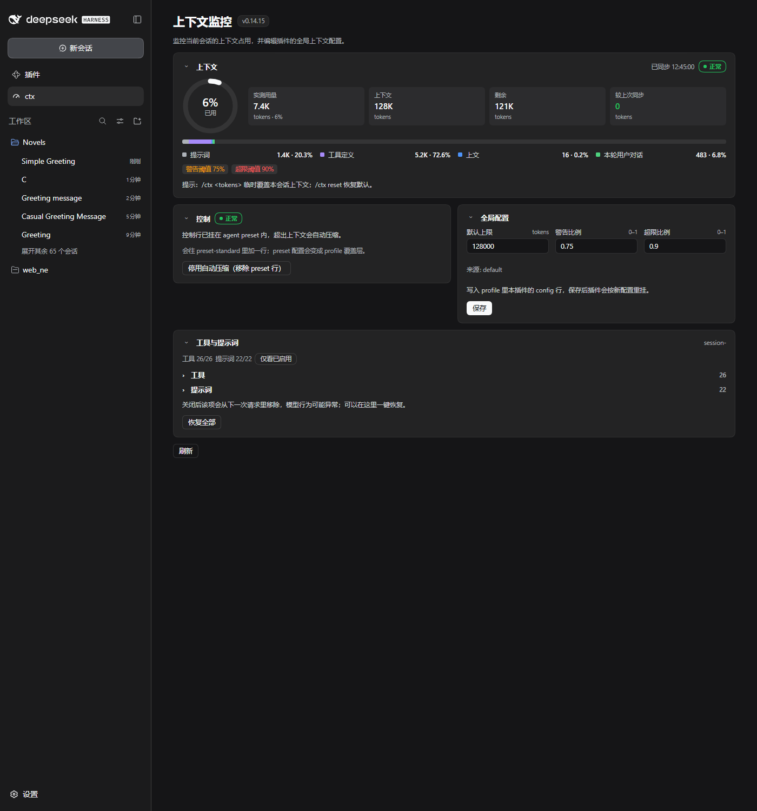

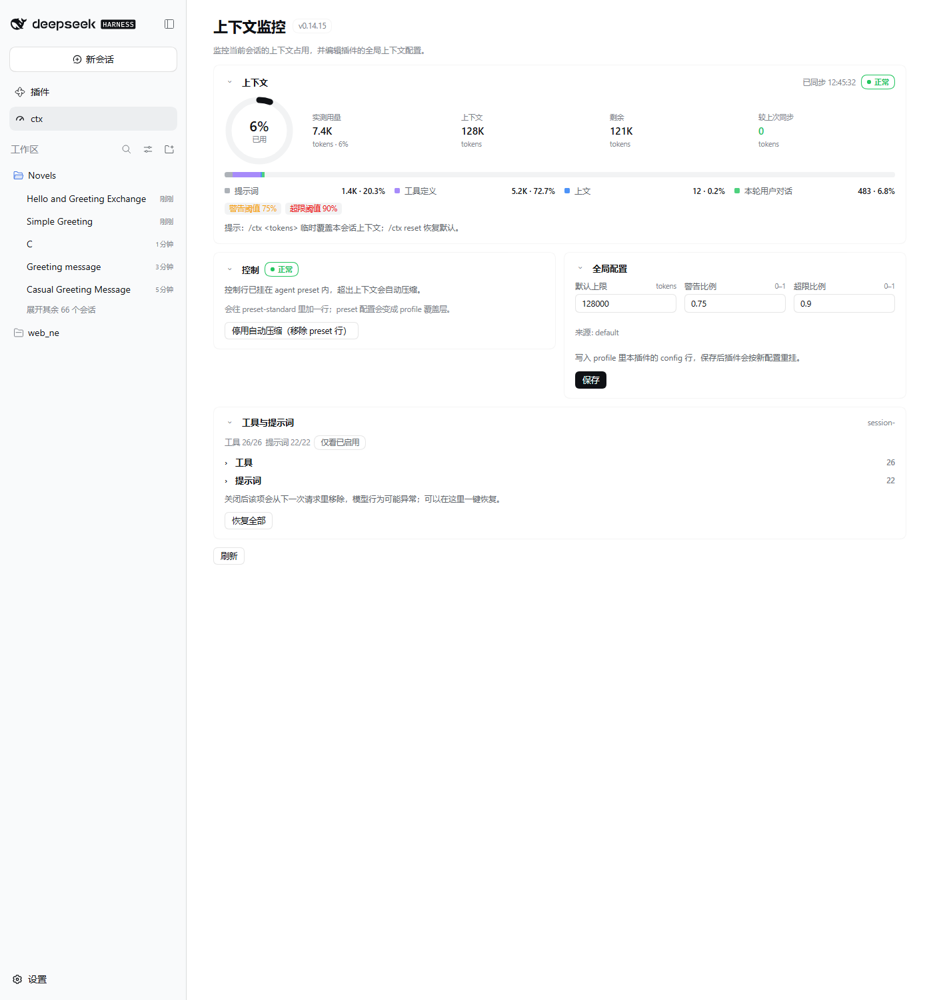

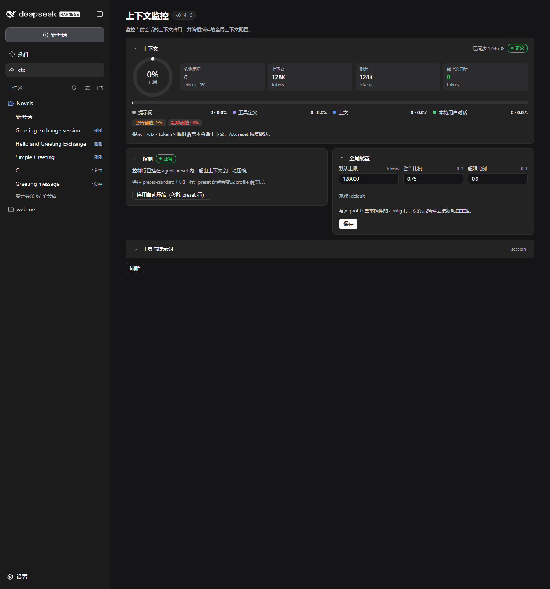

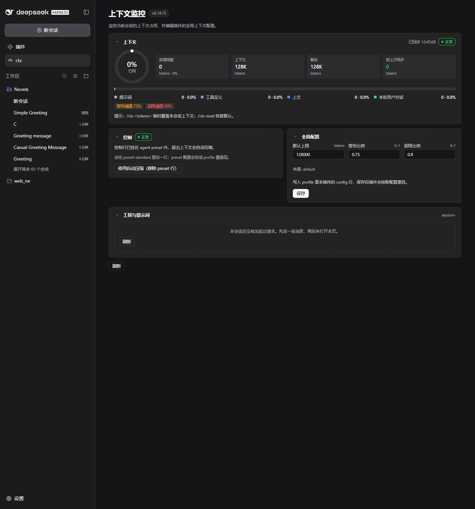

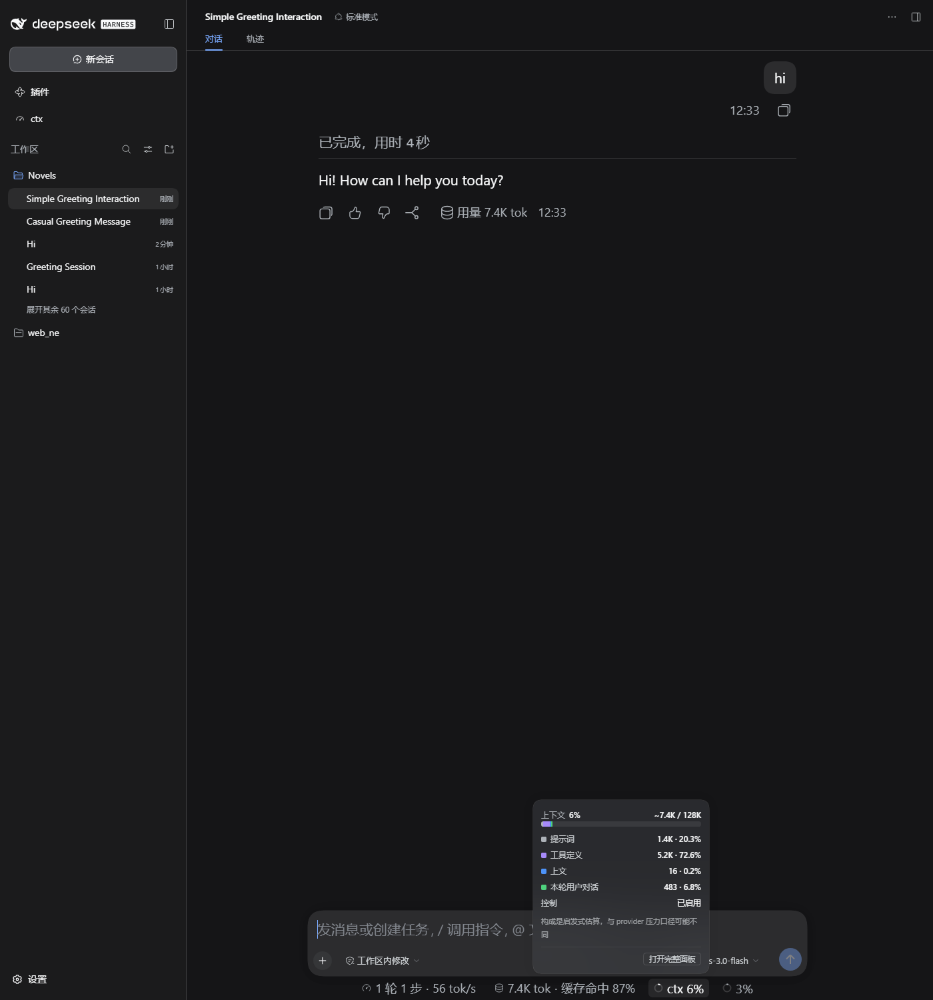

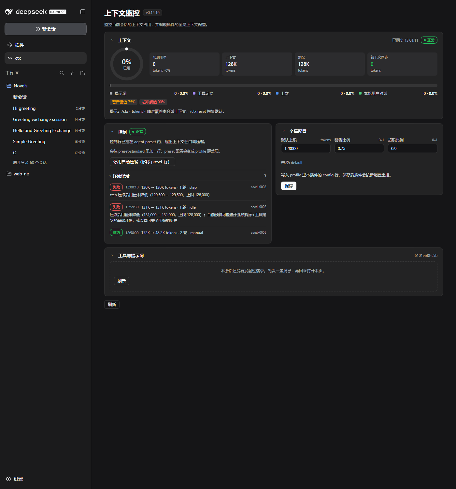

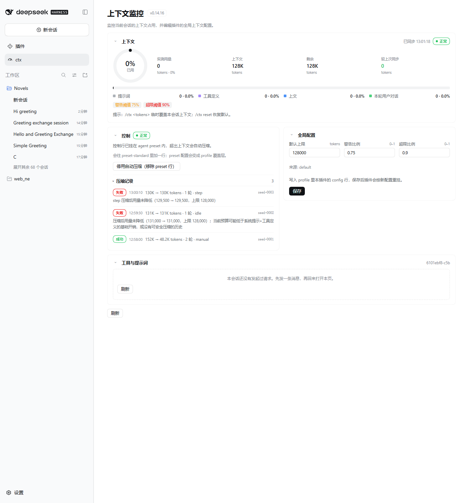

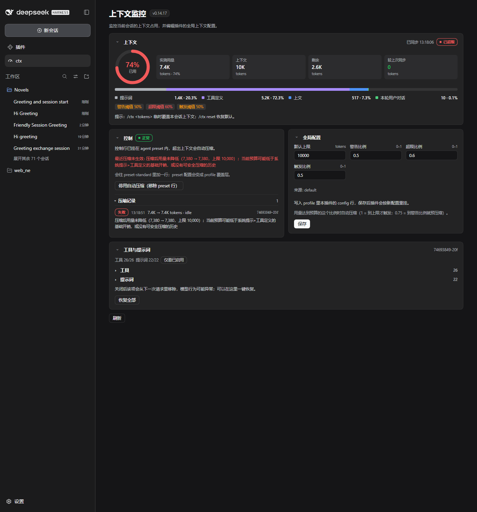

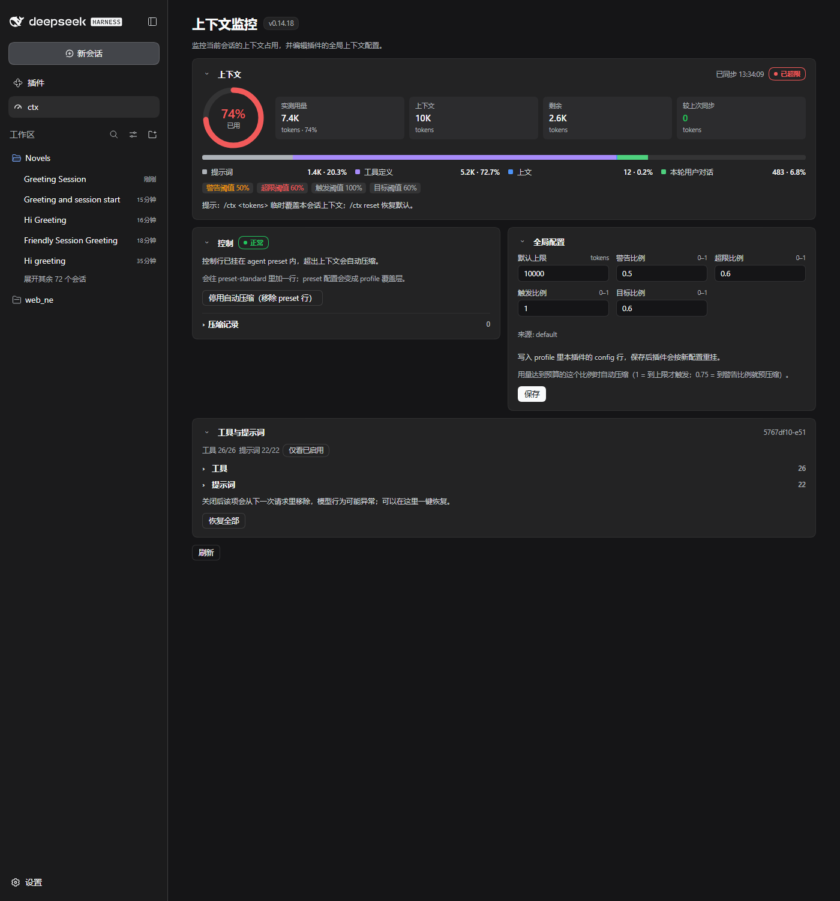

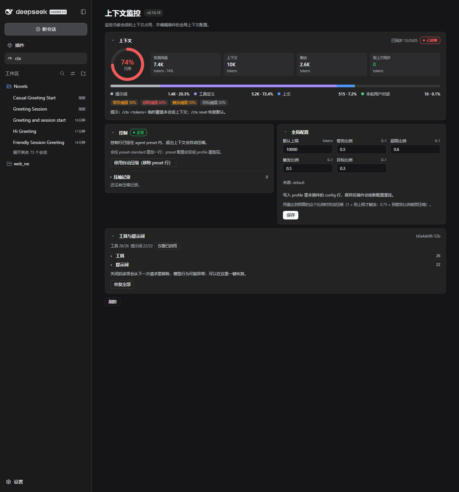

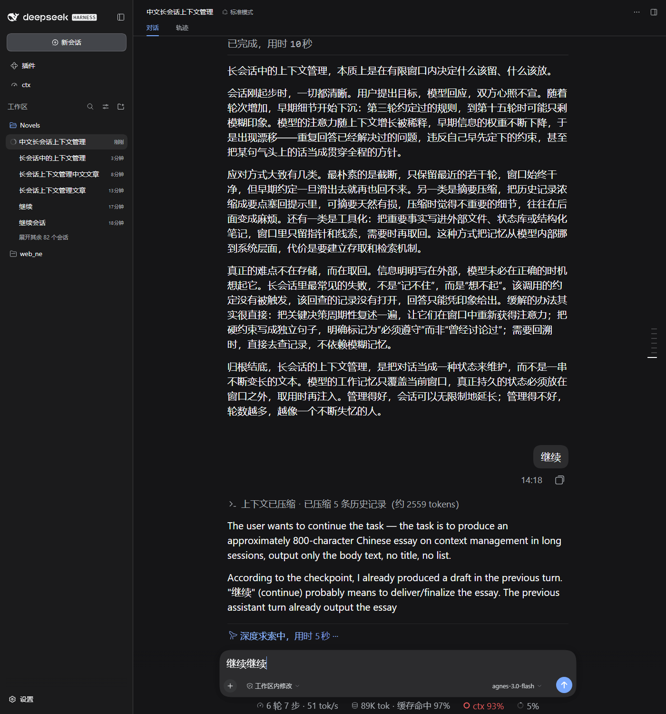

## 7. v0.15.0 落地：整页 tabs + 跨会话洞察

参考截图里的信息密度，把单页堆叠改成 **概览 / 趋势 / 事件 / 设置** 四个 tab；不复制整块「Context Insights」仪表盘，优先保留压缩可解释性与控制，再加轻量跨会话总览。

| 项目 | 落地 | 证据 |
| --- | --- | --- |
| P0 整页 tabs + sticky header | 四个 tab、范围 chips、刷新、正常/压缩中 badge | `docs/ui/0.15-overview.png` |
| P0 压缩记录可解释 | 前→后、target、轮次、耗时、成功/失败筛选；`state.js` 持久化新字段 | `docs/ui/0.15-events.png` |
| P0 逐轮趋势 | 请求 prompt/output 柱状 + 压缩标记 + 压缩耗时列表 | `docs/ui/0.15-trend.png` |
| P0 加载/错误/空态/重试 | 各 tab 的 skeleton、错误 banner、retry；空态文案 | 截图与 static 测试 |
| P1 宿主聚合 | `/status/analytics`、`/status/session-detail`；`sessionQuery` + `metrics.js` 纯折叠 | `test/metrics.mjs` 18/18 |
| P1 KPI 带 | 会话/tokens/缓存命中/费用估算/工具调用/活跃时长/压缩次数 | `docs/ui/0.15-overview.png` |
| P1 每日图 + 会话卡 | 7/30 天每日 tokens、活跃度热力；搜索/排序/展开/点击看趋势/打开会话 | 同上 |
| P1 设置合并 | 控制 + 全局配置 + 工具与提示词集中到设置 tab | `docs/ui/0.15-settings.png` |
| P2 热力 + 事件时间线 | 已做活动热力与压缩时间线；上下文浏览/drilldown/agent 网络未做 | 见下方局限 |
| 可维护性 | 新增宿主 `metrics.js`；折叠/聚合有纯函数测试；CSS token 与复用组件 | `test/metrics.mjs` |

**未做与原因**：

- 费用只对已知 DeepSeek 模型估算；当前 WSL 的 `agnes-3.0-flash` 无价格，显示 `—` 而不是编一个数字。
- 跨会话只扫描最近 40 个会话（界面标注覆盖率）；全量扫描会随会话增长变慢。
- 点击会话卡在页内看趋势；「打开会话」用标题匹配左侧会话列表做 DOM 桥接（没有公开的客户端切会话 API，匹配不到时静默不跳）。
- 趋势图未叠加 target 虚线（只在图例显示预算），后续可加。
- 上下文 composition 沿用原有实测数据，没有对历史会话逐条重算 tokenMeter（会非常慢）。
